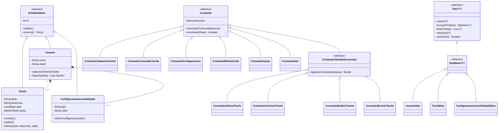

# Acessibilidade para pessoas com ausência bilateral dos membros superiores

## Sobre o projeto

**Tarefas Acessíveis** é uma aplicação de gerenciamento de tarefas com recursos de acessibilidade voltados para pessoas com ausência bilateral dos membros superiores.

O usuário pode cadastrar, consultar, alterar, concluir e excluir tarefas usando **comandos de voz** (ou o teclado, se preferir), e ouvir as respostas do sistema **em voz alta**. Assim, a aplicação reduz a dependência do teclado e do mouse e contribui para a autonomia do usuário.

> **Status:** implementação preparada para a 2ª entrega. Antes da submissão, execute os testes no computador do grupo e confirme a conexão com o MySQL.

## ODS

**ODS 10 - Redução das Desigualdades**

O projeto usa a tecnologia para diminuir barreiras de acesso e promover inclusão digital para pessoas com deficiência física: toda a gestão de tarefas pode ser feita por voz, sem depender de teclado e mouse.

## Tecnologias

| Tecnologia | Uso |
| --- | --- |
| Java 17+ | Linguagem da aplicação (Programação Orientada a Objetos) |
| MySQL 8+ | Banco de dados (persistência de usuários, tarefas e configurações) |
| JDBC (mysql-connector-j) | Conexão do Java com o MySQL |
| Windows PowerShell / System.Speech | Reconhecimento de fala e leitura em voz alta no Windows (dependem de microfone e pacote de fala instalado) |
| Git / GitHub | Versionamento |

## Arquitetura do sistema

Arquitetura simples em camadas, como definido na 1ª entrega:

```text
Interface (ui, interacao)  ->  Regras (comando, service, model)  ->  Acesso a dados (dao)  ->  MySQL
```

| Camada | Pacote | Responsabilidade |
| --- | --- | --- |
| Interface | `ui`, `interacao` | Telas em console, entrada por teclado/voz, saída em tela/voz |
| Regras da aplicação | `comando`, `service`, `model` | Comandos do usuário, regras de negócio (RN01–RN07), entidades |
| Acesso aos dados | `dao` | CRUD no MySQL com JDBC (`PreparedStatement`) |

## Estrutura do repositório

```text
/src/main/java/br/com/aep/tarefas
    app/        Main (ponto de entrada)
    model/      EntidadeBase, Usuario, Tarefa, ConfiguracaoAcessibilidade, StatusTarefa
    dao/        Dao, DaoBase, UsuarioDao, TarefaDao, ConfiguracaoAcessibilidadeDao, ConexaoBanco
    service/    UsuarioService, TarefaService
    comando/    Comando (abstrata) e seus comandos concretos
    interacao/  Entrada/Saida (teclado e voz), MotorVozWindows
    ui/         TelaInicial, TelaPrincipal
    util/       Texto (números e datas falados)
/database       script.sql (criação das tabelas) e dados_exemplo.sql
/docs           Diagramas de classes e DER
executar.bat    Compila e executa no Windows
executar.sh     Compila e executa no Linux/macOS
pom.xml         Projeto Maven (opcional, para IDEs)
README.md
```

## Requisitos

### RF01 - Cadastro de usuário
O sistema deverá permitir o cadastro de usuários, com nome e e-mail.

### RF02 - Cadastro de tarefas
O sistema deverá permitir o cadastro de tarefas com título, descrição, data e status.

### RF03 - Consulta de tarefas
O sistema deverá permitir a consulta das tarefas cadastradas.

### RF04 - Alteração de tarefas
O sistema deverá permitir a alteração de tarefas cadastradas.

### RF05 - Exclusão de tarefas
O sistema deverá permitir a exclusão de tarefas cadastradas.

### RF06 - Status da tarefa
O sistema deverá permitir marcar uma tarefa como "Pendente" ou "Concluída".

### RF07 - Configurações de acessibilidade
O sistema deverá permitir armazenar configurações de acessibilidade vinculadas ao usuário.

### RF08 - Comandos de voz
O sistema deverá permitir que determinadas funcionalidades sejam realizadas por comandos de voz.

### Onde cada requisito foi implementado

| Requisito | Implementação |
| --- | --- |
| RF01 | `TelaInicial.cadastrar()` → `UsuarioService.cadastrar()` → `UsuarioDao.inserir()`; alterar/excluir em `ComandoMinhaConta` |
| RF02 | `ComandoCadastrarTarefa` → `TarefaService.cadastrar()` → `TarefaDao.inserir()` |
| RF03 | `ComandoConsultarTarefa` → `TarefaService.listar()` → `TarefaDao.listarPorUsuario()` |
| RF04 | `ComandoAlterarTarefa` → `TarefaService.alterar()` → `TarefaDao.atualizar()` |
| RF05 | `ComandoExcluirTarefa` → `TarefaService.excluir()` → `TarefaDao.excluir()` |
| RF06 | `ComandoConcluirTarefa` / `ComandoReabrirTarefa` → `Tarefa.concluir()` / `Tarefa.reabrir()` |
| RF07 | `ComandoConfiguracoes` → `UsuarioService.alterarConfiguracao()` → `ConfiguracaoAcessibilidadeDao` |
| RF08 | `EntradaVoz` + `MotorVozWindows` (reconhecimento) e `SaidaTelaComVoz` (leitura em voz alta) |

## Requisitos não funcionais

- **RNF01 - Usabilidade:** menu numerado e curto; cada comando aceita número, frase digitada ou frase falada; "cancelar" volta ao menu em qualquer pergunta.
- **RNF02 - Persistência:** todos os dados são gravados no MySQL (nenhuma lista em memória substitui o banco).
- **RNF03 - Organização do código:** Programação Orientada a Objetos e camadas separadas.
- **RNF04 - Acessibilidade:** comandos de voz, leitura em voz alta com velocidade ajustável e alternativa automática para o teclado quando a voz não é entendida.

## Regras de negócio

- **RN01** - Cada usuário poderá possuir tarefas cadastradas no sistema (`Tarefa.validar()` exige usuário; FK `id_usuario`).
- **RN02** - Toda tarefa deverá possuir pelo menos um título e um status (`Tarefa.validar()`; `NOT NULL` no banco).
- **RN03** - As tarefas poderão possuir os status "Pendente" ou "Concluída" (`enum StatusTarefa`; `CHECK` no banco).
- **RN04** - O usuário poderá cadastrar, consultar, alterar e excluir suas tarefas (e somente as suas — `TarefaService.buscar()`).
- **RN05** - Determinadas funcionalidades podem ser realizadas por comandos de voz (todas as do menu).
- **RN06** - As configurações de acessibilidade estão relacionadas ao perfil do usuário (FK + `UNIQUE (id_usuario, tipo)`).
- **RN07** - As informações cadastradas são armazenadas no banco de dados do sistema.

## Programação Orientada a Objetos

| Pilar | Onde está no código |
| --- | --- |
| **Classe abstrata** | `Comando`, `ComandoTarefaSelecionada`, `EntidadeBase`, `DaoBase` |
| **Interface** | `Dao<T>`, `Entrada`, `Saida` |
| **Herança** | `ComandoCadastrarTarefa extends Comando`; `ComandoExcluirTarefa extends ComandoTarefaSelecionada extends Comando`; `Usuario`/`Tarefa`/`ConfiguracaoAcessibilidade extends EntidadeBase`; `TarefaDao extends DaoBase`; `SaidaTelaComVoz extends SaidaTela` |
| **Polimorfismo (@Override)** | `executar()` em cada comando (o `GerenciadorComandos` só conhece o tipo `Comando`); `validar()`/`resumo()` nas entidades; `inserir()`/`atualizar()`/`mapear()` nos DAOs; `mensagem()` em `SaidaTelaComVoz`; `ler()` em `EntradaTeclado`/`EntradaVoz` |
| **Composição 1:N** | `Usuario` possui a lista de `Tarefa` e de `ConfiguracaoAcessibilidade` (no banco: `ON DELETE CASCADE`) |
| **Encapsulamento** | atributos `private` com getters/setters; regras dentro das próprias entidades (`concluir()`, `alterar()`) |

Convenções: código tipado, classes em `PascalCase`, métodos e atributos em `camelCase`, constantes em `MAIUSCULAS`.

### Diagrama de classes (implementação)

O diagrama da 1ª entrega (`docs/diagrama-classes.jpeg`) foi seguido; abaixo, a versão completa da implementação, com as classes de apoio adicionadas.



## Banco de dados

O script `database/script.sql` cria o banco `aep_tarefas` com as tabelas do DER (`docs/der.jpeg`):

| Tabela | Classe Java | Relacionamento |
| --- | --- | --- |
| `usuario` | `Usuario` | — |
| `tarefa` | `Tarefa` | N:1 com `usuario` (FK `id_usuario`, `ON DELETE CASCADE`) |
| `configuracao_acessibilidade` | `ConfiguracaoAcessibilidade` | N:1 com `usuario` (FK `id_usuario`, `ON DELETE CASCADE`) |

CRUD sobre a entidade principal (**Tarefa**):

| Operação | Método | SQL |
| --- | --- | --- |
| Create | `TarefaDao.inserir()` | `INSERT INTO tarefa ...` |
| Read | `TarefaDao.listarPorUsuario()` / `buscarPorId()` | `SELECT ... FROM tarefa` |
| Update | `TarefaDao.atualizar()` | `UPDATE tarefa SET ...` |
| Delete | `TarefaDao.excluir()` | `DELETE FROM tarefa ...` |

Usuários e configurações também têm CRUD pelos seus DAOs.

## Como executar

### 1. Pré-requisitos

- **JDK 17 ou superior** (`java -version` e `javac -version` no terminal).
- **MySQL Server 8.0 ou superior**, iniciado como serviço.
- **Apache Maven 3.9 ou superior** (`mvn -version`). O Maven baixa automaticamente o driver JDBC declarado no `pom.xml`.
- **Comandos de voz (opcional):** Windows 10/11, microfone e reconhecedor de fala pt-BR instalado. O reconhecimento e a leitura em voz alta usam os recursos de fala do Windows; sem eles, utilize o teclado.

### 2. Criar o banco de dados

Abra o MySQL Workbench, conecte-se à sua instância e execute todo o conteúdo de `database/script.sql` (ícone do raio). O script cria o banco `aep_tarefas` e as tabelas necessárias. Não é preciso criar as tabelas manualmente.

Opcional: execute `database/dados_exemplo.sql` para inserir um usuário demonstrativo e três tarefas.

### 3. Configurar a conexão

Na pasta principal do projeto, faça uma cópia de `db.properties.example` e renomeie a cópia para `db.properties`. Edite as três propriedades conforme a sua instalação:

```properties
db.url=jdbc:mysql://localhost:3306/aep_tarefas?useSSL=false&allowPublicKeyRetrieval=true&serverTimezone=America/Sao_Paulo&characterEncoding=UTF-8
db.usuario=root
db.senha=sua_senha_do_mysql
```

**Atenção à porta:** `3306` é a porta padrão. Se o seu MySQL Server foi configurado para `3307`, altere somente o número da porta na URL. Nunca envie o arquivo `db.properties` ao GitHub, pois ele contém a senha.

### 4. Compilar e executar no Windows

Abra o Prompt de Comando na pasta do projeto e execute:

```bat
mvn clean compile
mvn exec:java
```

Ou, depois de configurar `db.properties`, dê dois cliques em `executar.bat`. Para iniciar diretamente no modo de voz (Windows):

```bat
executar.bat --voz
```

Na primeira execução, o Maven precisa de internet para baixar o driver JDBC e os plugins.

**Linux/macOS:** configure `db.properties` e execute `sh executar.sh`.

**Pela IDE:** importe a pasta como projeto Maven e execute `br.com.aep.tarefas.app.Main`.

## Como usar

1. Na tela inicial, cadastre um usuário (opção 2) ou entre (opção 1) com o e-mail ou o número do usuário.
2. No menu, diga ou digite o comando:

| Nº | Comando | Frases de voz |
| --- | --- | --- |
| 1 | Nova tarefa | "nova tarefa", "criar tarefa" |
| 2 | Listar tarefas | "listar tarefas", "minhas tarefas" |
| 3 | Alterar tarefa | "alterar tarefa", "editar tarefa" |
| 4 | Concluir tarefa | "concluir tarefa", "finalizar tarefa" |
| 5 | Reabrir tarefa | "reabrir tarefa", "marcar como pendente" |
| 6 | Excluir tarefa | "excluir tarefa", "apagar tarefa" |
| 7 | Configurações | "configurações", "acessibilidade" |
| 8 | Minha conta | "minha conta", "perfil" |
| 9 | Ajuda | "ajuda", "comandos" |
| 0 | Sair | "sair", "encerrar" |

- Números podem ser falados ("tarefa doze", "vinte e um").
- Datas: "hoje", "amanhã", "depois de amanhã", "sem data" ou `dd/mm/aaaa`.
- "cancelar" volta ao menu a qualquer momento.
- Para ligar a voz: menu **7 - Configurações** → *comandos de voz* → sim. A leitura em voz alta e a velocidade da fala também ficam lá e são salvas no banco.
- Se a voz não for entendida 3 vezes seguidas, o sistema pede a resposta pelo teclado para não travar.

## Cronograma do projeto

Cronograma definido na 1ª entrega:

| Período | Atividade | Responsável |
| --- | --- | --- |
| 15/08 a 27/08 | Organização das classes e estrutura inicial do projeto | Lucas |
| 28/08 a 01/09 | Desenvolvimento do banco de dados e das funções de cadastro, consulta, alteração e exclusão | Nicolas |
| 02/09 a 03/09 | Desenvolvimento dos comandos de voz | Gustavo |
| 04/09 a 09/09 | Testes, correções e organização da entrega | Todos |

## Organização do grupo

As atividades de desenvolvimento, documentação, banco de dados e testes devem ser registradas de acordo com a participação efetiva de cada integrante. Os commits do GitHub podem ser usados para demonstrar a evolução do projeto.

## Apoio utilizado no desenvolvimento

Foram utilizadas ferramentas de apoio, incluindo inteligência artificial, para esclarecer dúvidas, revisar trechos de código e organizar a documentação. As decisões do projeto e a conferência do funcionamento devem ser acompanhadas pelos integrantes do grupo.

## Integrantes

- Lucas Marinho — RA 25017750-2
- Gustavo de Araújo Marangoni — RA 25178508-2
- Nicolas Antonio da Silva Lima — RA 25201421-2

## Repositório

**Link do repositório:** https://github.com/Gustavo-Marangoni/aep-acessibilidade-tarefas
